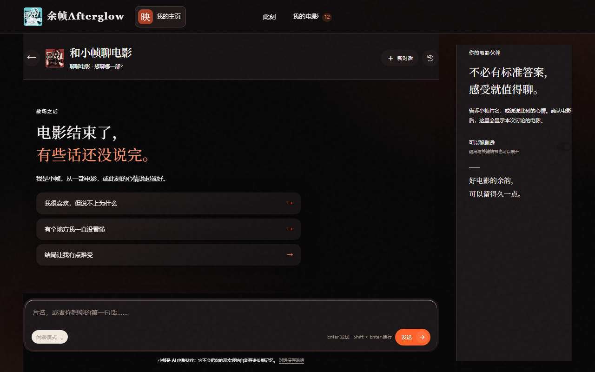
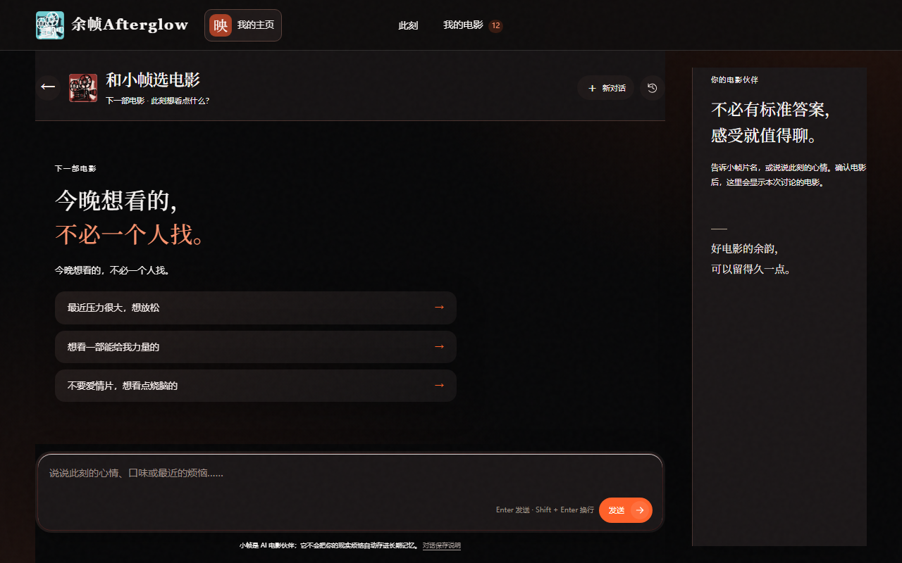

<div align="center">


# 余帧 Afterglow

**让推荐有来处，让讨论有后续，让记忆始终由你决定。**

一个真正记得你电影经验的 AI 电影伙伴

🔗 **[在线体验 · 立即试用 →](https://scjr6ugp5e1uskemefhmn.apigateway-cn-beijing.volceapi.com/)**

[](LICENSE)


[](https://scjr6ugp5e1uskemefhmn.apigateway-cn-beijing.volceapi.com/)

</div>

---

## 这是什么

余帧 Afterglow 不是替你打分，也不是再给你一张热门榜。它从你真实看过、喜欢、犹豫和拒绝过的电影出发，陪你选择下一部，也陪你把看完后的感受慢慢说清楚。

> 电影散场以后，故事才刚刚开始。
>
> 总有一帧画面，懂你此刻的心情。

电影从来不缺评分、榜单和片单。真正困难的是：院线新片太多，不知道今晚该选哪部；刚看完一部电影，心里有很多感觉，有时只想聊清楚，有时又需要整理成可发布的内容；反复观看同一作品后，新认识和旧想法散落在不同地方。余帧 Afterglow 把这些原本断开的瞬间连成一条连续的电影关系：

**用 1～5 部真实电影建立起点 → 看见并修正自己的口味画像 → 获得不重复的推荐 → 围绕具体电影自然讨论 → 按需整理内容或记录多次观看 → 由你确认愿意保留的东西 → 让后续推荐与回顾继续使用这些证据。**

## 功能亮点

| 能力 | 说明 |
| --- | --- |
| 🎬 **聊电影** | 从一句真实感受开始，围绕具体电影自然讨论；支持指定电影、同名版本确认、剧透开关、语音输入与回复、历史对话 |
| 🎯 **找电影** | 按「此刻的你」推荐，理解心情、时长、同行、口味与排除项，在数据层排除已看电影 |
| ✍️ **新片内容创作** | 把零散观感整理成小红书观后、个人正式影评或影视宣推草稿，默认不保存、不自动发布 |
| 🔁 **多次观影认知沉淀** | 反复观看的每次感悟作为独立时间切片保存，可与上次并列比较 |
| 🗂️ **个人电影轨迹** | 看过 / 想看 / 不感兴趣统一管理，已看自动退出推荐候选 |
| 🧭 **可见口味画像** | 结论可见、可修正、可删除，只描述电影偏好，不推断人格或现实身份 |
| 📝 **可控观后感** | AI 只生成草稿，由你编辑、确认、锁定、解锁与删除，带版本控制 |
| 🎥 **院线新片决策** | 在当前院线新片里给出明确首选 + 需要接受的取舍 + 最多两个备选 |
| 📤 **克制分享** | 只分享你明确授权的最小内容，链接可设有效期、可随时撤回 |
| 🎙️ **语音交互** | 按住说话 + AI 语音回复（可自动播放 / 手动播放） |

AI 伙伴叫「小帧」：平等、克制、诚实，明确自己的 AI 身份，不冒充真人，不把电影偏好扩张成人格、健康或现实关系推断。

> 数据与隐私：成功的聊天会同步到服务端保存（`conversation_records` 表），供管理员按账户查看；敏感现实信息不会自动进入长期电影记忆。

## 界面预览

| 聊电影 | 找电影 |
| :---: | :---: |
|  |  |

## 快速开始

要求 **Python 3.12**、**Node.js 24 LTS**、npm 和 [uv](https://docs.astral.sh/uv/)。

```bash
git clone https://github.com/czm2952795093-star/Afterglow.git
cd Afterglow
npm --prefix frontend ci
npm --prefix frontend run build

AFTERGLOW_HOST=127.0.0.1 \
AFTERGLOW_LOCAL_OPEN_ACCESS=true \
uv run --isolated --python 3.12 \
  --with-requirements requirements.txt \
  python app.py serve
```

启动后：

- 用户端：<http://127.0.0.1:8765/>
- 产品介绍页：<http://127.0.0.1:8765/landing>
- 管理端：<http://127.0.0.1:8765/admin>

macOS 用户可直接双击 `启动余帧Afterglow.command` 一键启动（本机免认证模式，固定 `127.0.0.1:8765`）。

> 多人或公网部署请勿开启 `AFTERGLOW_LOCAL_OPEN_ACCESS`，并从 `.env.example` 配置密钥。附加能力（搜索、语音、图像）未配置时会安全降级，不影响主文字回复。

## 技术栈

- **后端**：Python 3.12 · FastAPI · SQLite（WAL）· 自研 Agent 工具循环
- **前端**：原生 HTML/CSS/JS + Next.js App Router 静态导出外壳
- **能力**：TMDB 电影资料 · Web Search · 语音（ASR/TTS）· 图像生成
- **部署**：Dockerfile · Railway · veFaaS · GitHub Actions SSH 自动发布

## 项目结构

| 路径 | 职责 |
| --- | --- |
| `app.py` | CLI、依赖组装和 Uvicorn 启动 |
| `fastapi_app.py`、`server.py` | FastAPI 桥接、认证、用户与管理员 API |
| `agent.py` | Agent 提示词、工具循环、Skill 注入与安全短路 |
| `storage.py` | SQLite schema、迁移、事务、账户隔离与业务数据 |
| `integrations.py`、`voice.py`、`image_models.py` | 电影、搜索、语音和图像供应商 |
| `product_skills.py` | 三个内置 Skill 的定义与默认版本 |
| `web/` | 用户端与管理端静态资源及交互 |
| `frontend/` | Next.js App Router 静态导出外壳 |
| `scripts/` | 发布、部署与 SQLite 维护脚本 |

## 配置

所有配置通过环境变量完成，模板见 [`.env.example`](.env.example)。核心项：

| 变量 | 说明 |
| --- | --- |
| `AFTERGLOW_HOST` / `AFTERGLOW_PORT` | 绑定地址与端口 |
| `AFTERGLOW_LOCAL_OPEN_ACCESS` | 仅回环地址的本机免认证模式 |
| `AFTERGLOW_DATABASE` | SQLite 数据库路径 |
| `AFTERGLOW_INVITE_PEPPER` / `AFTERGLOW_SESSION_SECRET` / `AFTERGLOW_ADMIN_TOKEN` | 邀请码、会话与管理员凭据 |
| `MODEL_*` / `TMDB_*` / `WEB_SEARCH_*` / `VOICE_*` / `IMAGE_*` | 模型、电影、搜索、语音与图像供应商 |

## 验证

```bash
uv run --isolated --python 3.12 \
  --with-requirements requirements.txt \
  python -m unittest discover -s tests -p 'test_*.py'

npm --prefix frontend run build
npm --prefix frontend run test:ui
npm --prefix frontend run typecheck
npm --prefix frontend run lint
npm --prefix frontend run verify:parity
```

## 许可证

本项目采用 [MIT License](LICENSE) 开源。你可以使用、复制、修改和分发本项目代码，但必须保留版权与许可证声明；软件按「现状」提供，不附带任何担保。
